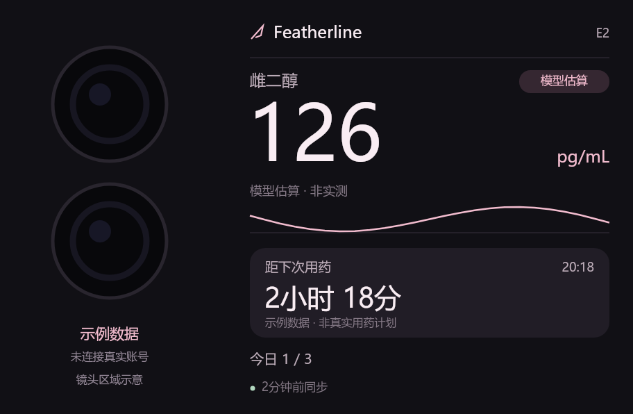

# Featherline 背屏适配测试版

基于官方 Featherline 1.4.2（提交 `c9a417deb2ebee29448899134951e9ddc380b6aa`），新增可选的背屏数据导出。修改日期：2026-10-21。本项目是第三方适配测试版，不是 Featherline 官方发布。

背屏显示雌二醇模型估算值与趋势、下一次计划用药倒计时、今日记录进度。浓度复用原 App 的小组件计算结果；日程使用原 App 的计划与记录匹配逻辑。不会自动记录用药或改变计划。

[下载测试版 APK](https://github.com/misakayuuki/featherline-rear-card/releases/download/v0.1.0/Featherline-RearCard-0.1.0-arm64-debug.apk) · [完整源码包](https://github.com/misakayuuki/featherline-rear-card/releases/download/v0.1.0/Featherline-RearCard-0.1.0-source.zip) · [发布说明](https://github.com/misakayuuki/featherline-rear-card/releases/tag/v0.1.0) · [验证记录](VERIFICATION.md)

## 安装与使用

1. 在手机安装支持 API 2 的 [rear-card-bridge](https://github.com/finall1008/rear-card-bridge)，按该项目说明完成背屏所需授权。
2. 安装 `dist/Featherline-RearCard-0.1.0-arm64-debug.apk`。桌面名称为 **Featherline 背屏测试版**，包名为 `com.mkx.hrttracker.debug`。
3. 在原 Featherline 导出加密备份，再用测试版的原有备份恢复功能导入。两个 App 的数据空间独立；之后需要在**背屏测试版**继续记录用药，原版中的新记录不会自动复制过来。请保留原版及备份，核对恢复结果后再使用。
4. 在测试版中打开 **设置 → 外观 → Featherline 背屏**，选择 **开启同步并绑定**。如果提示数据未就绪，回到首页等加载完成再试。
5. 在卡片桥选择并绑定背屏载体，按提示到系统背屏设置移除旧卡、重新应用该载体，再返回 Featherline。首次需要完成载体绑定，后续数据更新自动推送。

无需手动安装单独的模块 ZIP；App 会发送包含当前数据的完整模块。`dist/featherline-rear-card-0.1.0.zip` 只是无个人数据的初始模块，单独安装不会获得浓度或日程。

## 更新与显示规则

- 记录、计划、显示单位和“隐藏用药详情”变化会沿用原 App 的小组件更新流程推送。也可以点击 **立即同步**。
- 后台复用原有约 15 分钟周期任务；Android 省电策略可能延迟执行。系统休眠时背屏脚本也可能暂停，唤醒后按实际时间重算倒计时。
- 同步间隔目前固定在 Featherline 程序中，没有卡片桥内的间隔选项。背屏运行期间每分钟刷新显示；手动同步入口在 Featherline 测试版的背屏设置中。
- 浓度来自原 App 对已记录用药的模型估算，并非血检实测值。卡片在有效曲线内插值，不向曲线外推算，不根据未来计划虚构已服药记录。
- 超过 30 分钟未同步会标注缓存；超过 24 小时隐藏旧浓度与旧计划。今日进度在本地午夜后等待同步。到达计划时间只提示核对记录，不自动跳到下一次或标记已服用。
- 未来计划搜索范围为 90 天；超过该范围时显示“暂无近期安排”。

## 关闭与隐私

同步默认关闭。开启后，卡片桥会保存一份显示摘要，背屏可显示这些信息；Featherline 的应用锁无法保护卡片桥内的副本。原 App 的“隐藏用药详情”会隐藏药物/分组名称，但浓度和时间仍然显示。

**关闭并清空显示** 会停止后续推送、撤销临时文件授权，并向卡片桥发送空数据。背屏要等系统下次读取载体才会清空；桥内旧快照也要等新卡片执行后覆盖。需要立即删除桥内模块及其保存的数据时，请在卡片桥卸载本模块。手机尚未刷新时，已显示的静止画面仍可能暂时保留。

新增接口只向指定卡片桥授予临时 ZIP 读取权限，不新增网络权限或常驻服务，不导出数据库、完整历史或备份密码。开启状态不随系统备份恢复。

## 源码与构建

- `Featherline/`：完整修改后的 Android 源码，保留上游许可证。
- `module/`：生产背屏模块源码。
- `tests/`：模块数据规则和渲染生命周期回归测试。
- `build-module.mjs`：用卡片桥官方编译器生成 App 内置资源及初始模块 ZIP。
- `preview/`：使用虚构数据生成的外观预览。

开发说明见 [Featherline/docs/rear-card.md](Featherline/docs/rear-card.md)。源码包包含 Android 工程及已编译模块资源，构建 Android APK 不要求重新编译 JavaScript。上游构建读取 Git 版本信息，从本仓库克隆或源码 ZIP 构建时，应先按开发说明在 `Featherline/` 内恢复上游 Git 元数据。

这是可安装的开发测试版本，使用调试签名，无法覆盖官方签名版本。构建和自动测试不代表已在小米真机验证；首次使用仍需核对本机系统、载体绑定、休眠唤醒和日程显示。

## 上游

- [Featherline](https://github.com/mkx173/Featherline)
- [背屏模块开发文档](https://github.com/finall1008/rear-card-bridge/blob/main/docs/module-development.md)

Featherline 及本适配的新增代码按 GNU GPL v3 发布，见 `Featherline/LICENSE`。原项目第三方声明保留在 `Featherline/docs/third-party-notices.md`。
